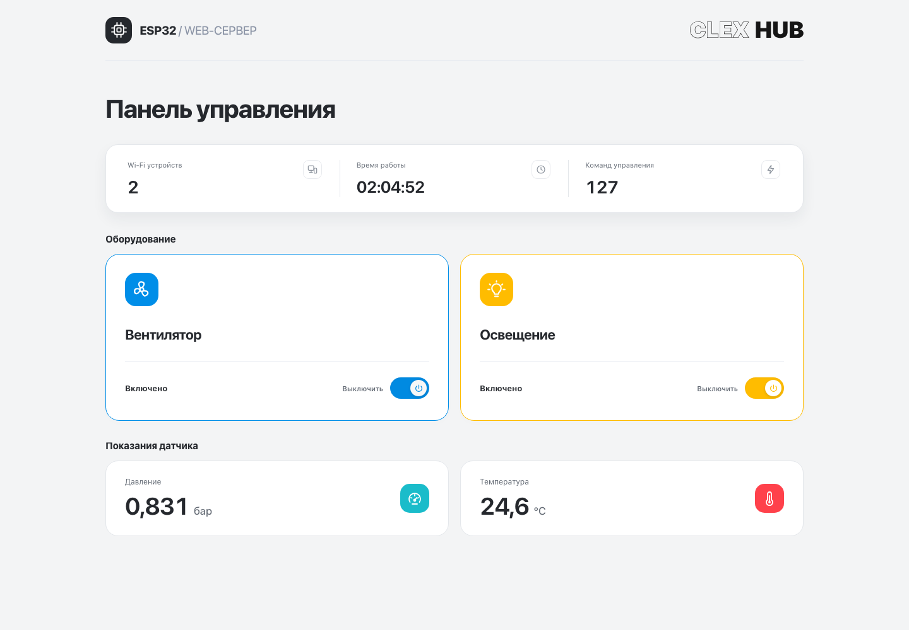

# Веб-сервер на ESP32

Управление вентилятором и освещением из браузера через Wi-Fi ESP32. Проект для **ESP32 DevKit WROOM-32 с Flash 4 МБ**, среда разработки **ESP-IDF 5.4.4**.

ESP32 создаёт собственную точку доступа. Телефон или компьютер подключается к ней напрямую; роутер и интернет для работы не требуются. HTML, CSS, JavaScript и логотип находятся в прошивке.

| Параметр | Значение |
| --- | --- |
| Сеть Wi-Fi | **ESP32-SERVER** |
| Пароль | **12345678** |
| Адрес страницы | **http://192.168.4.1** |
| Wi-Fi устройства | До 4 одновременно |



[Интерфейс на телефоне](docs/interface-mobile.png). На изображениях показаны демонстрационные значения.

## Возможности

- Независимое включение и выключение вентилятора и освещения.
- Синхронизация состояния между открытыми страницами.
- Количество подключённых Wi-Fi устройств, время работы ESP32 и счётчик команд.
- Давление XGZP6847D в барах и температура датчика в °C.
- Адаптивный интерфейс для телефона и компьютера.

Используются встроенные компоненты ESP-IDF. Сторонних веб-библиотек, MQTT, NAT, базы данных и облачного сервиса нет. Страница открывается по IP-адресу, авторизация на ней не требуется.

## Что понадобится

- ESP32 DevKit с модулем WROOM-32 и USB-кабель с передачей данных.
- Релейный модуль для вентилятора и MOSFET-модуль для светильника с управляющими входами, совместимыми с логикой 3,3 В.
- Отдельное питание нагрузок и релейного модуля по их номинальному напряжению.
- Датчик XGZP6847D с интерфейсом I²C, если нужны показания давления и температуры.

Для демонстрации предусмотрены низковольтные нагрузки постоянного тока. GPIO передаёт сигнал управления, а не питание нагрузки.

## Подключение

| Назначение | Контакт ESP32 |
| --- | --- |
| Управляющий вход реле вентилятора | GPIO25 |
| Управляющий вход MOSFET светильника | GPIO26 |
| SDA датчика | GPIO21 |
| SCL датчика | GPIO22 |
| Питание датчика | 3V3 |
| Общий провод | GND |

Подробности подключения, питание модулей и выводы датчика: [схема и таблицы](docs/wiring.md), [схема SVG](docs/wiring.svg).

## Настройки

Настройки находятся в [main/app_config.h](main/app_config.h).

```c
#define APP_FAN_GPIO            25
#define APP_FAN_ACTIVE_LEVEL    1
#define APP_LIGHT_GPIO          26
#define APP_LIGHT_ACTIVE_LEVEL  1
```

Значение `1` задаёт включение уровнем HIGH, `0` задаёт включение уровнем LOW. Выберите активный уровень отдельно для каждого модуля по его документации или положению переключателя. При настройках по умолчанию включение соответствует HIGH, выключение соответствует LOW.

В начале программы оба выхода устанавливаются в выключенное состояние. Состояние нагрузок после перезапуска не восстанавливается. Уровни входов модулей до запуска программы определяются их схемой и подтяжками, описанными в инструкции подключения.

### Датчик давления

Поддерживается **XGZP6847D с адресом 0x6D**, регистром команды `0x30` и данными `0x06–0x0A`. Серия XGZP6847DC с другим протоколом не поддерживается.

По умолчанию задан диапазон **от −100 до 300 кПа**, то есть **от −1 до 3 бар**, с коэффициентом **K = 16**. Для другого исполнения задайте коэффициент по паспорту датчика.

```c
#define APP_SENSOR_ENABLED         1
#define APP_SENSOR_SDA_GPIO        21
#define APP_SENSOR_SCL_GPIO        22
#define APP_SENSOR_I2C_ADDRESS     0x6D
#define APP_SENSOR_INTERNAL_PULLUP 1
#define APP_SENSOR_K               16
#define APP_SENSOR_PERIOD_MS       1000
```

Опрос выполняется раз в секунду. Внутренние подтяжки I²C включены. Если датчик не используется, установите `APP_SENSOR_ENABLED` в `0`: опрос отключится, карточки датчика будут скрыты.

Температура относится к самому датчику. При отсутствии показаний страница показывает причину ошибки I²C; управление нагрузками продолжает работать.

## Сборка и прошивка на macOS

### 1. Подготовить ESP-IDF

Нужна версия **5.4.4**. Если она уже установлена, активируйте её окружение. Для новой установки с Homebrew:

```bash
xcode-select --install
brew install cmake ninja dfu-util python@3.12
export PATH="$(brew --prefix python@3.12)/libexec/bin:$PATH"
mkdir -p ~/esp
cd ~/esp
git clone --branch v5.4.4 --recursive https://github.com/espressif/esp-idf.git esp-idf-v5.4.4
cd esp-idf-v5.4.4
./install.sh esp32
. ./export.sh
idf.py --version
```

Если Command Line Tools уже установлены, повторять `xcode-select --install` не нужно. [Официальная инструкция Espressif для macOS](https://docs.espressif.com/projects/esp-idf/en/v5.4.4/esp32/get-started/linux-macos-setup.html).

В новом окне Terminal активируйте установленное окружение:

```bash
export PATH="$(brew --prefix python@3.12)/libexec/bin:$PATH"
. ~/esp/esp-idf-v5.4.4/export.sh
```

### 2. Скачать и собрать проект

```bash
git clone https://github.com/proxymades/esp32-web-server.git
cd esp32-web-server
idf.py set-target esp32
idf.py build
```

Можно также скачать ZIP через **Code → Download ZIP** на GitHub и открыть распакованную папку в Terminal. Все команды проекта выполняются из папки с `CMakeLists.txt`.

### 3. Подключить плату и прошить

Подключите ESP32 по USB и посмотрите доступные порты:

```bash
ls /dev/cu.*
```

Выберите порт платы и укажите его в переменной `PORT`. Ниже приведено стандартное имя USB-UART CP210x; на вашей системе имя может отличаться.

```bash
PORT=/dev/cu.SLAB_USBtoUART
idf.py -p "$PORT" flash monitor
```

Команда запишет прошивку и откроет журнал. Выход из монитора: **Ctrl+]**. Если соединение останавливается на `Connecting`, удерживайте BOOT до начала записи. Для платы без автоматического сброса войдите в загрузчик кнопками BOOT и EN.

После изменения настроек или страницы повторите:

```bash
idf.py build
idf.py -p "$PORT" flash monitor
```

Ресурсы страницы включаются в бинарный файл автоматически. Отдельная загрузка HTML и файловой системы не требуется.

### Запуск через Espressif Installation Manager

Для ESP-IDF 5.4.4, установленного через Espressif Installation Manager, доступен скрипт [idf.sh](idf.sh). Он подключает установленное окружение при каждом запуске:

```bash
bash ./idf.sh --version
bash ./idf.sh build
bash ./idf.sh -p "$PORT" flash monitor
```

Скрипт принимает аргументы `idf.py`; без аргументов выполняет сборку. При ручной установке ESP-IDF используйте команды `idf.py` после активации окружения, как показано выше.

## Открыть панель управления

1. Подключитесь к **ESP32-SERVER** с паролем **12345678**.
2. Останьтесь в этой сети, даже если телефон сообщает об отсутствии интернета.
3. Откройте **http://192.168.4.1**.
4. Управляйте нагрузками переключателями «Вентилятор» и «Освещение».

Состояние хранится на ESP32. Активные страницы запрашивают его примерно раз в 500 мс. При отправке команды блокируется только переключатель выбранной нагрузки; соседний остаётся доступным. Браузер может замедлять обновление фоновых вкладок.

Счётчик учитывает корректно обработанные команды управления, включая повторную установку того же состояния. Опрос страницы и ошибочные запросы не учитываются. Счётчик сбрасывается при перезапуске ESP32.

Количество Wi-Fi устройств означает число клиентов точки доступа, а не число открытых вкладок. Потеря связи с браузером сама по себе не выключает нагрузку. Отображаемое состояние соответствует заданному уровню GPIO; обратная связь от силовых контактов не предусмотрена.

## Файлы проекта

| Файл | Назначение |
| --- | --- |
| `main/main.c` | GPIO, Wi-Fi, HTTP и обработка команд |
| `main/app_config.h` | Контакты, активные уровни, Wi-Fi и датчик |
| `main/sensor.c`, `main/sensor.h` | Опрос XGZP6847D |
| `main/web/index.html` | HTML, CSS, JavaScript, значки и встроенный логотип |
| `main/web/clexhub.svg` | Логотип CLEXHUB |
| `sdkconfig.defaults` | Настройки ESP32 и Flash 4 МБ |
| `idf.sh` | Запуск окружения Espressif Installation Manager |
| `docs/wiring.md`, `docs/wiring.svg` | Подключение оборудования |
