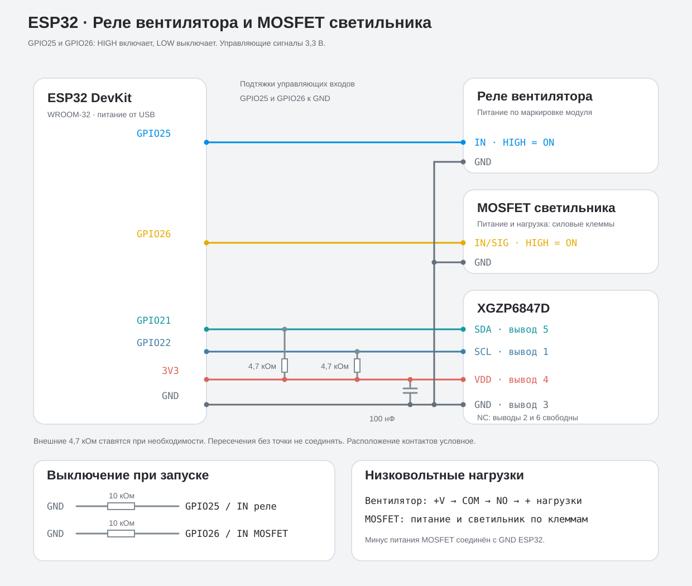

# Подключение



ESP32 DevKit WROOM-32 управляет реле вентилятора и MOSFET светильника. Оба управляющих входа работают с логикой 3,3 В. GPIO25 и GPIO26 включаются уровнем HIGH. На схеме показаны сигнальные соединения готовых модулей; расположение и названия силовых клемм определяются их маркировкой.

## Управление

| GPIO | Нагрузка | Включение | Выключение |
| --- | --- | --- | --- |
| GPIO25 | Реле вентилятора | HIGH, 3,3 В | LOW, 0 В |
| GPIO26 | MOSFET светильника | HIGH, 3,3 В | LOW, 0 В |

| От ESP32 | Куда подключить |
| --- | --- |
| GPIO25 | Управляющий вход IN релейного модуля |
| GPIO26 | Управляющий вход IN/SIG MOSFET-модуля |
| GND | GND обоих модулей и минусы их источников питания |
| GPIO21 | SDA датчика XGZP6847D |
| GPIO22 | SCL датчика XGZP6847D |
| 3V3 | VDD датчика |
| GND | GND датчика |

GPIO указаны по электрическим именам. Расположение на гребёнке зависит от варианта DevKit. [Контакты ESP32-DevKitC WROOM](https://docs.espressif.com/projects/esp-dev-kits/en/latest/esp32/esp32-devkitc/user_guide.html).

Питание релейного модуля подключите к источнику его номинального напряжения. MOSFET-модуль и светильник подключите к источнику напряжения светильника по маркировке силовых клемм. Управляющий вход и силовая цепь MOSFET не являются одним контактом. Через GPIO передаётся только сигнал управления.

ESP32 можно питать через USB. Нагрузки и катушка реле питаются отдельно. Минус питания MOSFET должен быть соединён с GND ESP32. Для показанной схемы с общей землёй GND релейного модуля также соединяется с GND ESP32. Внешнее питание модулей не подключается к VIN/5V ESP32 одновременно с USB.

## Выключение при запуске

Если на модулях нет подходящих подтяжек, для удержания выключенного состояния до запуска программы используются 10 кОм от GPIO25 к GND и 10 кОм от GPIO26 к GND. Дополнительные резисторы не требуются при наличии таких подтяжек на модулях.

В `main/app_config.h` параметр `APP_FAN_ACTIVE_LEVEL` равен `1`, `APP_LIGHT_ACTIVE_LEVEL` равен `1`. В начале `app_main` прошивка записывает LOW для GPIO25 и GPIO26 до включения GPIO на выход. Состояние ON не сохраняется после перезапуска.

Перед подключением нагрузок проверьте выключенное состояние реле и MOSFET при включении питания и нажатии EN. Активный уровень в программе должен соответствовать входу подключённого модуля.

## Вентилятор через реле

```text
+ питания вентилятора -> COM реле
NO реле              -> + вентилятора
- питания вентилятора -> - вентилятора
```

NO является нормально разомкнутым контактом; NC не используется. Контакты реле должны соответствовать напряжению и пусковому току вентилятора. Для демонстрации используются низковольтные нагрузки постоянного тока. Силовая цепь вентилятора не соединяется с GPIO.

## Светильник через MOSFET

GPIO26 подключается к управляющему входу модуля. HIGH включает светильник, LOW выключает. Подключите источник питания и светильник к соответствующим силовым клеммам модуля. Обозначения IN/SIG на схеме означают функцию входа, а не физический номер вывода транзистора. Распиновка отдельного MOSFET здесь не задаётся.

## XGZP6847D

| Вывод DIP6 | Назначение | Подключение |
| --- | --- | --- |
| 1 | SCL | GPIO22 |
| 2 | NC | Не подключать |
| 3 | GND | GND |
| 4 | VDD | 3V3 |
| 5 | SDA | GPIO21 |
| 6 | NC | Не подключать |

Ориентацию корпуса определяйте по метке первого вывода и чертежу датчика. Для готового модуля используйте подписи на плате. Внутренние подтяжки ESP32 включены в прошивке. Если на модуле уже есть подтяжки SDA/SCL к 3V3, дополнительные резисторы не нужны. Внешние 4,7 кОм на схеме показаны как вариант для шины без подходящих подтяжек; необходимость определяется конкретным модулем и проводкой. Между VDD и GND рядом с датчиком установите 100 нФ.

Диапазон датчика от −100 до 300 кПа, коэффициент K = 16. Давление отображается в барах, температура датчика в °C. Шина I²C работает на 100 кГц, адрес оригинальной серии 0x6D. [CFSensor XGZP6847D V2.5](https://www.endrich.com/Datenbl%C3%A4tter/Sensoren/XGZP6847D-Pressure-Sensor-V2.5.pdf).
